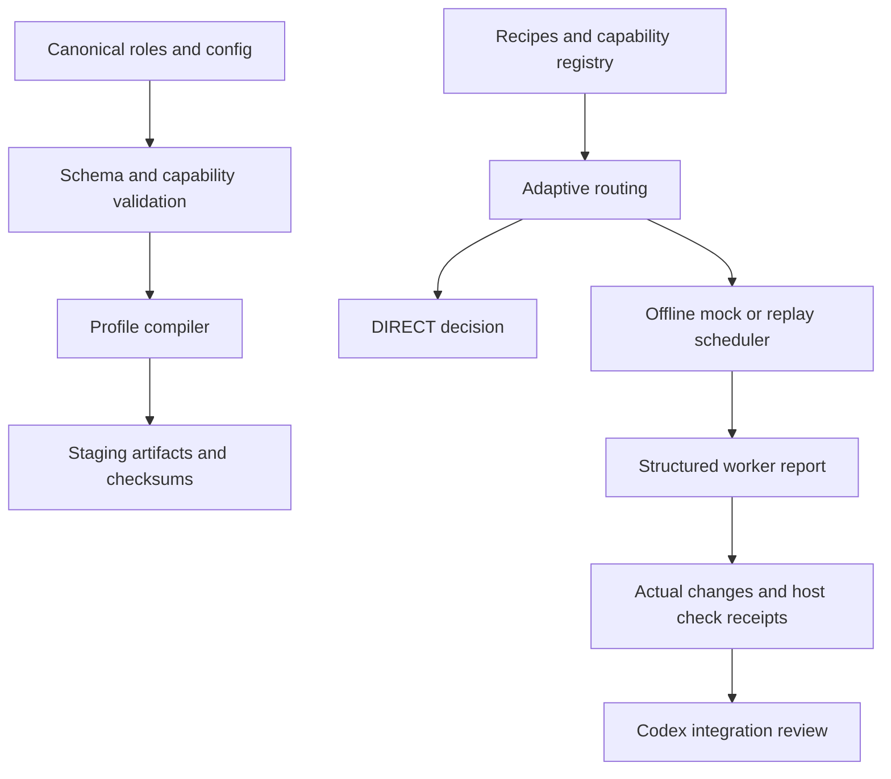

# Architecture

## Phạm vi

Một canonical source tạo provider-specific artifacts vào staging. Router offline giúp kiểm thử quyết định DIRECT/DELEGATED/TEAM. Scheduler chỉ điều phối adapter local Mock/Replay. Core CLI không gọi Codex, Antigravity hoặc Gemini và không ghi live config. Luồng giao việc qua chat nằm ở phần cuối.

## Thành phần

| Path | Trách nhiệm |
|---|---|
| `config/`, `agents/roles/`, `agents/teams/`, `workflows/recipes/` | Canonical definitions; không chứa runtime sessions |
| `workflows/schemas/` | Contracts version 1.0, strict subset JSON Schema 2020-12 |
| `src/core/router.mjs` | Chọn recipe/mode/worker bound và explicit fallback |
| `src/core/scheduler.mjs` | Offline DAG, ownership, attempts, review và cancellation |
| `src/core/store.mjs` | Atomic JSON state, exclusive writer lock trong `state/` |
| `src/adapters/offline.mjs` | Synthetic worker và replay report đã làm sạch |
| `src/verification/checks.mjs` | Snapshot, actual diff, registered Node checks, host-owned receipts |
| `src/compiler/` | Conversion có kiểm tra loss of constraints, checksum/provenance |
| `legacy/` | Source references; không có copied runtime, installer, ledger hoặc token |

Không tạo folder rỗng. `scripts/verify.mjs` chạy bộ lệnh kiểm chứng và lưu source fingerprints/logs riêng trong ignored state; không có monitoring UI hoặc background process.

## Trust boundaries

Worker report là dữ liệu không đáng tin. Schema từ chối property thừa, trạng thái PASS/done và path traversal. Actual workspace diff phải khớp report và write scope. Report không thể nộp check receipt bằng lời khai: host tự chạy registered checks, xác minh hash input/spec và freshness trước accept.

Mock/Replay không thực thi code do worker gửi, không ghi file theo report, không dispatch subprocess AI và không có network code. Registered checks là code tin cậy của repository, chỉ chạy Node với shell=false trong fixture workspace; đây không phải OS sandbox cho arbitrary scripts.

Advisory ownership và kiểm tra sau thực thi không ngăn một process tùy ý ghi ra ngoài máy. Native write adapter bị disabled vì chưa có isolation được kiểm chứng. Khi có executor thật, cần worktree/sandbox/provider grants riêng và integration owner duyệt diff. Không dùng việc pass mock test để tuyên bố security boundary production.

## Adaptive planning

DIRECT cho scope nhỏ hoặc delegation không có lợi. DELEGATED yêu cầu backend enabled/available/verified, ownership/dependencies rõ và expected benefit đạt threshold. TEAM thêm milestone, independent units và parallel capability; tối đa hai worker offline. Con số role trong profile không phải số agent sẽ spawn.

Năm recipe định nghĩa activation, planning depth, inputs, roles, decomposition, parallelism, acceptance, verification, recovery và completion. Router dùng `trigger_kind`, `suggested_roles`, `planning_depth`, `max_parallelism`, `direct_fallback`. Required inputs/acceptance cần được Codex kiểm tra ở bước lập brief; foundation không tự suy luận tính đúng của tiêu chí nghiệp vụ.

Nếu critical capability mất thì BLOCKED. DIRECT fallback chỉ được phép khi request cho phép và không làm mất yêu cầu quan trọng. Không chọn adapter disabled/unverified. Mọi native executor hiện vẫn disabled dù format được tài liệu mô tả.

## V2.2 host-native guidance

`src/native/guidance.mjs` là pure recommendation riêng với `execution: NOT EXECUTED`; caller-supplied host observations không phải security attestation. Nó dùng cùng thresholds, recipes, team eligibility và concurrency limits; không gọi scheduler hoặc AI API, không sửa capability registry. Native Codex trong parent session sở hữu lifecycle và báo kết quả trực tiếp. Smoke trong phiên hiện tại chứng minh hai default subagents đã tham gia; không chứng minh registry adapter, custom discovery hoặc permission isolation.

`config/integrations/codex-guidance.json` map sáu logical roles sang parent, built-ins và hai advisory review profiles. Strict converter vẫn từ chối hard constraints không thể biểu diễn. Hai profile không phải conversion bảo toàn read-only/task-scoped permissions. Compiler tạo guidance/profile staging; bundle planner chỉ inspect declared project paths, báo collision/diff và stage trong ignored state. Không có installer, global config write hoặc duplicate dispatcher. Matching recipe được đọc theo nhu cầu; không load toàn bộ framework cho task nhỏ.

V2.3 binds immutable project bundles to the normalized reviewed target root, reports non-directory ancestor/non-file target collisions, and rejects dangling links. A runnable isolated project validates manual opt-in/update/rollback without adding a lifecycle or installer. Bounded context and handoff provenance are guidance; [legacy compatibility audit](../audit/v2.3-bridge-compatibility.md) keeps installed V1 consumer dispatch BLOCKED and documented future SDK/API routes DESIGN-ONLY.

## State và reliability

Một store mới riêng dưới project `state/`; không dùng SQLite V1. Stable idempotency key gắn hash payload, duplicate task ID/cycle/dependency không tồn tại bị từ chối atomically. Reader/writer scope conflicts giữ task queued; task review giữ ownership đến khi accept/rework. Bounded wait không tự redispatch. Failed task cần explicit retry trong budget tối đa hai rework.

Restart giữ queued/review/failure state. Task đang running được `recover()` chuyển BLOCKED vì delivery/outcome chưa chắc chắn. Receipts cache nằm trong process host; sau restart cần chạy check lại. Lock bị bỏ lại sau hard crash không tự xóa: người vận hành xác minh không còn writer trước khi dọn riêng lock. State không được chứng nhận chống sửa bởi user/process cùng tài khoản.

Cancellation dừng adapter mock hợp tác với AbortSignal, không tuyên bố dừng agent native. Integration/merge và planning/dispatch AI cost chưa được triển khai; metrics không đo được phải là null.

## Giao việc qua chat

MCP `antigravity_gui` và CLI dùng chung một sender. Sender lưu đường dẫn job và tạo file status trước khi submit brief vào chat đang mở bằng Windows background messages. Project và model được đọc từ GUI. Anti cập nhật file status của job, còn Codex ghi receipt gửi riêng. Lịch sử thử nghiệm Desktop Inbox đã nghỉ nằm trong [audit](../audit/desktop-inbox-bridge.md). [Quy trình hiện hành](../operations/antigravity-chat.md)
